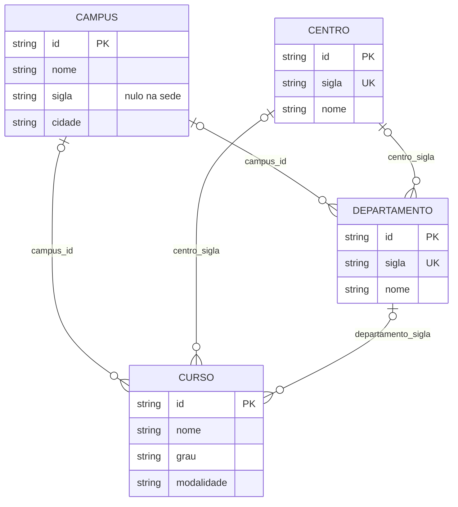
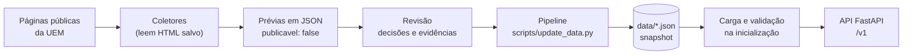

<div align="center">

# uemAPI

**Câmpus, centros, departamentos e cursos da Universidade Estadual de Maringá em uma API REST,<br>com a origem e a data de consulta de cada registro.**

<br>

[](https://github.com/HenriqueSagawa/uemAPI/actions/workflows/tests.yml)


[](LICENSE)


<br>

[Início rápido](#início-rápido) &nbsp;·&nbsp;
[Convenções](#convenções-da-api) &nbsp;·&nbsp;
[Referência](#referência-da-api) &nbsp;·&nbsp;
[Modelos](#modelos-de-dados) &nbsp;·&nbsp;
[Dados publicados](#dados-publicados) &nbsp;·&nbsp;
[Por dentro](#como-funciona-por-dentro) &nbsp;·&nbsp;
[Contribuir](#contribuir)

</div>

<br>

> **Esta é uma API comunitária, independente e não oficial.** Não tem vínculo com a UEM, não é endossada pela universidade e não substitui nenhum canal institucional. Os dados vêm de páginas públicas, passaram por revisão registrada neste repositório e têm limitações documentadas [mais abaixo](#limitações-conhecidas). Para qualquer decisão que dependa de precisão (matrícula, prazos, documentos), confirme na fonte oficial.

<br>

## Sumário

1. [Visão geral](#visão-geral)
2. [Início rápido](#início-rápido)
3. [Convenções da API](#convenções-da-api)
4. [Referência da API](#referência-da-api)
5. [Erros](#erros)
6. [Modelos de dados](#modelos-de-dados)
7. [Dados publicados](#dados-publicados)
8. [Como funciona por dentro](#como-funciona-por-dentro)
9. [Gerando e verificando o snapshot](#gerando-e-verificando-o-snapshot)
10. [Coletores e revisão](#coletores-e-revisão)
11. [Configuração](#configuração)
12. [Qualidade e integração contínua](#qualidade-e-integração-contínua)
13. [Limites atuais](#limites-atuais)
14. [Próximas etapas](#próximas-etapas)
15. [Contribuir](#contribuir)
16. [Licença](#licença)
17. [Autores](#autores)

<br>

## Visão geral

As informações básicas sobre a estrutura da UEM estão espalhadas por vários sites: uma página lista os câmpus, outra os centros de ensino, os departamentos aparecem dentro das páginas de cada centro e os cursos ficam em um portal próprio da Pró-Reitoria de Ensino. A uemAPI junta tudo isso em quatro conjuntos de dados com identificadores estáveis, consultáveis por HTTP.

Duas decisões de projeto explicam boa parte do que você vai encontrar aqui.

**Cada registro diz de onde veio.** O campo `fonte` traz o identificador da fonte, a URL da página consultada e o momento exato da consulta, com fuso horário. Se um dado parecer estranho, você sabe onde conferir.

**Dado não comprovado fica `null`.** A API não preenche por semelhança de nome nem por dedução. Se ninguém verificou a qual centro um curso pertence, o campo é `null`, e não um palpite que pareça razoável. Isso deixa algumas lacunas visíveis no snapshot atual, que estão listadas com todas as letras em [Limitações conhecidas](#limitações-conhecidas).

### O que está publicado na v0.1.0

| Conjunto | Registros | Identificador | Fonte |
| --- | ---: | --- | --- |
| Câmpus | 7 | `id` (`sede`, `crc`, `cau`...) | `campi_uem` |
| Centros de ensino | 7 | `sigla` (`CCA`, `CTC`...) | `centros_pld` |
| Departamentos | 49 | `sigla` (`DIN`, `DEM`...) | `centros_pld` |
| Cursos presenciais de graduação | 67 | `id` (`sede-medicina`...) | `cursos_graduacao` |

A captura mais recente usada no snapshot é de `2026-10-22T17:58:32Z`. Cursos de graduação a distância (EaD) e pós-graduação não fazem parte desta versão.

<br>

## Início rápido

### Com Python

Requer **Python 3.13 ou superior**.

```bash
git clone https://github.com/HenriqueSagawa/uemAPI.git
cd uemAPI

python3.13 -m venv .venv
source .venv/bin/activate          # no Windows: .venv\Scripts\activate

python -m pip install -e '.[dev]'
python -m uvicorn app.main:app --reload
```

O servidor sobe em `http://127.0.0.1:8000`. A documentação interativa fica em [`/docs`](http://127.0.0.1:8000/docs) (Swagger UI) e em [`/redoc`](http://127.0.0.1:8000/redoc).

### Com Docker

```bash
docker build -t uem-api .
docker run --rm -p 8000:8000 uem-api
```

A imagem já inclui o snapshot de `data/` e roda com um usuário sem privilégios (`appuser`, uid 10001).

### Primeiras requisições

Antes de tudo, confirme que os dados foram carregados:

```bash
curl http://127.0.0.1:8000/v1/health
```

```json
{
  "status": "ready",
  "version": "0.1.0",
  "datasets": {
    "campi": 7,
    "centros": 7,
    "departamentos": 49,
    "cursos": 67
  },
  "snapshot_consultado_em": "2026-10-22T17:58:32.788772Z"
}
```

Depois, explore:

```bash
# Todos os câmpus
curl http://127.0.0.1:8000/v1/campi

# Um centro, com a lista de siglas dos seus departamentos
curl http://127.0.0.1:8000/v1/centros/ctc

# Departamentos de um centro
curl "http://127.0.0.1:8000/v1/departamentos?centro=CCE"

# Cursos de um câmpus
curl "http://127.0.0.1:8000/v1/cursos?campus=cau"

# Um curso específico
curl http://127.0.0.1:8000/v1/cursos/sede-ciencia-da-computacao

# Filtro com acento: deixe o curl codificar o valor
curl -G http://127.0.0.1:8000/v1/cursos \
  --data-urlencode "campus=sede" \
  --data-urlencode "grau=Médico"
```

### Consumindo em código

Percorrer todas as páginas de uma lista em Python:

```python
import httpx

BASE = "http://127.0.0.1:8000"


def listar(recurso: str, **filtros):
    pagina = 1
    while True:
        resposta = httpx.get(
            f"{BASE}/v1/{recurso}",
            params={**filtros, "page": pagina, "page_size": 100},
        )
        resposta.raise_for_status()
        corpo = resposta.json()
        yield from corpo["data"]
        if pagina * corpo["meta"]["page_size"] >= corpo["meta"]["total"]:
            break
        pagina += 1


for curso in listar("cursos", campus="sede"):
    print(curso["id"], "-", curso["nome"])
```

O mesmo em JavaScript (Node 18+), tratando o formato de erro da API:

```js
const BASE = "http://127.0.0.1:8000";

async function buscar(caminho, params = {}) {
  const url = `${BASE}/v1/${caminho}?${new URLSearchParams(params)}`;
  const resposta = await fetch(url);
  const corpo = await resposta.json();

  if (!resposta.ok) {
    throw new Error(`${corpo.error.code}: ${corpo.error.message}`);
  }
  return corpo;
}

const { data, meta } = await buscar("cursos", { campus: "cau", page_size: 100 });
console.log(`${meta.total} cursos`, data.map((curso) => curso.nome));
```

<br>

## Convenções da API

| Tema | Como funciona |
| --- | --- |
| **Prefixo** | Todas as rotas de dados ficam sob `/v1`. A documentação OpenAPI fica na raiz: `/docs`, `/redoc` e `/openapi.json`. |
| **Métodos** | Somente `GET`. A API é de leitura. |
| **Formato** | JSON em UTF-8. Datas em ISO 8601, sempre com fuso horário. |
| **Paginação** | `page` (a partir de 1) e `page_size` (padrão 50, máximo 100). Listas devolvem `{ "data": [...], "meta": {...} }`. |
| **Ordenação** | Fixa: por `nome` (sem diferenciar maiúsculas de minúsculas) e, em caso de empate, por `id`. Não há parâmetro de ordenação. |
| **Maiúsculas e minúsculas** | Ignoradas em identificadores de rota e em filtros. `/v1/campi/CRC` e `/v1/campi/crc` devolvem o mesmo registro. |
| **Filtros** | Comparação exata de texto, combinados com `E` quando mais de um é informado. Não há busca parcial nem busca textual. |
| **Acentos** | Importam. `grau=Médico` encontra o curso de Medicina, `grau=medico` não encontra nada. |
| **Valores vazios** | Um filtro informado e vazio (`?campus=`) é rejeitado com 422. |
| **Proveniência** | Todo registro carrega `fonte` com `source_id`, `url` e `consultado_em`. |
| **Situação** | Todo registro tem `status`: `ativo`, `inativo` ou `desconhecido`. Hoje todos estão como `desconhecido`. |

### Paginação em detalhe

A resposta de qualquer lista tem este formato:

```json
{
  "data": [ ],
  "meta": { "page": 1, "page_size": 50, "total": 67 }
}
```

`total` é o número de registros depois de aplicados os filtros, não o tamanho da página. O número de páginas é `ceil(total / page_size)`. Pedir uma página além do fim não é erro: a API devolve `data` vazio e o mesmo `total`.

```bash
curl "http://127.0.0.1:8000/v1/cursos?page=4&page_size=20"
# 7 registros, meta: { "page": 4, "page_size": 20, "total": 67 }

curl "http://127.0.0.1:8000/v1/campi?page=9"
# { "data": [], "meta": { "page": 9, "page_size": 50, "total": 7 } }
```

<br>

## Referência da API

### Resumo das rotas

| Método | Rota | Devolve | Filtros |
| --- | --- | --- | --- |
| `GET` | [`/v1/health`](#get-v1health) | Estado do serviço e contagens | |
| `GET` | [`/v1/campi`](#get-v1campi) | Lista de câmpus | |
| `GET` | [`/v1/campi/{id}`](#get-v1campiid) | Um câmpus | |
| `GET` | [`/v1/centros`](#get-v1centros) | Lista de centros | |
| `GET` | [`/v1/centros/{sigla}`](#get-v1centrossigla) | Um centro, com seus departamentos | |
| `GET` | [`/v1/departamentos`](#get-v1departamentos) | Lista de departamentos | `centro`, `campus` |
| `GET` | [`/v1/departamentos/{sigla}`](#get-v1departamentossigla) | Um departamento | |
| `GET` | [`/v1/cursos`](#get-v1cursos) | Lista de cursos | `campus`, `centro`, `grau`, `modalidade` |
| `GET` | [`/v1/cursos/{id}`](#get-v1cursosid) | Um curso | |

Todas as listas aceitam `page` e `page_size`, descritos em [Convenções](#convenções-da-api).

---

### `GET /v1/health`

Informa se o snapshot foi carregado e quantos registros cada conjunto tem. Serve para verificação de saúde em contêineres e orquestradores.

| Situação | Código | `status` |
| --- | :---: | --- |
| Snapshot carregado e válido | `200` | `ready` |
| Snapshot ausente ou inválido | `503` | `unavailable` |

Quando está indisponível, o corpo continua no mesmo formato, com `datasets` vazio e `snapshot_consultado_em` nulo. `snapshot_consultado_em` é a data de consulta mais recente entre todos os registros carregados.

<details>
<summary>Exemplo de resposta com o serviço sem dados</summary>

```json
{
  "status": "unavailable",
  "version": "0.1.0",
  "datasets": {},
  "snapshot_consultado_em": null
}
```

</details>

---

### `GET /v1/campi`

Lista os sete câmpus, ordenados por nome.

<details>
<summary>Exemplo: <code>/v1/campi?page_size=2</code></summary>

```json
{
  "data": [
    {
      "id": "crc",
      "nome": "Câmpus Regional de Cianorte",
      "status": "desconhecido",
      "fonte": {
        "source_id": "campi_uem",
        "url": "https://www.uem.br/a-uem/campus",
        "consultado_em": "2026-10-16T15:28:56.372959Z"
      },
      "sigla": "CRC",
      "cidade": "Cianorte",
      "endereco": null
    },
    {
      "id": "crg",
      "nome": "Câmpus Regional de Goioerê",
      "status": "desconhecido",
      "fonte": {
        "source_id": "campi_uem",
        "url": "https://www.uem.br/a-uem/campus",
        "consultado_em": "2026-10-16T15:28:56.372959Z"
      },
      "sigla": "CRG",
      "cidade": "Goioerê",
      "endereco": null
    }
  ],
  "meta": { "page": 1, "page_size": 2, "total": 7 }
}
```

</details>

### `GET /v1/campi/{id}`

Devolve um câmpus pelo `id`. Os valores possíveis são `sede`, `crc`, `crg`, `car`, `crn`, `cau` e `crv`. A regra de formação dos IDs está em [Identificadores de câmpus](#identificadores-de-câmpus).

<details>
<summary>Exemplo: <code>/v1/campi/sede</code></summary>

```json
{
  "id": "sede",
  "nome": "Câmpus Sede",
  "status": "desconhecido",
  "fonte": {
    "source_id": "campi_uem",
    "url": "https://www.uem.br/a-uem/campus",
    "consultado_em": "2026-10-16T15:28:56.372959Z"
  },
  "sigla": null,
  "cidade": "Maringá",
  "endereco": null
}
```

A sede tem `sigla: null` de propósito: não foi encontrada uma sigla institucional para ela, e a API não inventa uma.

</details>

---

### `GET /v1/centros`

Lista os sete centros de ensino. Esta lista traz o centro sem os departamentos; para obtê-los, use a rota de detalhe.

### `GET /v1/centros/{sigla}`

Devolve um centro pela `sigla` (`CCA`, `CCB`, `CCE`, `CCH`, `CCS`, `CSA` ou `CTC`). Além dos campos do centro, a resposta inclui `departamentos`: as siglas dos departamentos vinculados, em ordem alfabética.

<details>
<summary>Exemplo: <code>/v1/centros/ctc</code></summary>

```json
{
  "id": "ctc",
  "nome": "CENTRO DE TECNOLOGIA",
  "status": "desconhecido",
  "fonte": {
    "source_id": "centros_pld",
    "url": "https://pld.uem.br/dvl/regulamentos/centros-de-ensino",
    "consultado_em": "2026-10-16T15:29:31.827522Z"
  },
  "sigla": "CTC",
  "departamentos": [
    "DAL", "DAM", "DAU", "DDM", "DEC",
    "DEM", "DEP", "DET", "DIN", "DTC"
  ]
}
```

O nome vem em maiúsculas porque é assim que a fonte o apresenta. A API preserva o texto observado.

</details>

---

### `GET /v1/departamentos`

Lista os 49 departamentos.

| Parâmetro | Descrição |
| --- | --- |
| `centro` | Sigla do centro. Ex.: `CCE`. |
| `campus` | ID do câmpus. Ex.: `sede`. Com o snapshot atual o resultado é sempre vazio (veja [Limitações](#limitações-conhecidas)). |

<details>
<summary>Exemplo: <code>/v1/departamentos?centro=CCE&amp;page_size=3</code></summary>

```json
{
  "data": [
    {
      "id": "dci",
      "nome": "Departamento de Ciências",
      "status": "desconhecido",
      "fonte": {
        "source_id": "centros_pld",
        "url": "https://pld.uem.br/dvl/regulamentos/centros-de-ensino/centro-de-ciencias-exatas-cce",
        "consultado_em": "2026-10-16T16:41:26.583225Z"
      },
      "sigla": "DCI",
      "centro_sigla": "CCE",
      "campus_id": null
    },
    {
      "id": "des",
      "nome": "Departamento de Estatística",
      "status": "desconhecido",
      "fonte": {
        "source_id": "centros_pld",
        "url": "https://pld.uem.br/dvl/regulamentos/centros-de-ensino/centro-de-ciencias-exatas-cce",
        "consultado_em": "2026-10-16T16:41:26.583225Z"
      },
      "sigla": "DES",
      "centro_sigla": "CCE",
      "campus_id": null
    },
    {
      "id": "dfi",
      "nome": "Departamento de Física",
      "status": "desconhecido",
      "fonte": {
        "source_id": "centros_pld",
        "url": "https://pld.uem.br/dvl/regulamentos/centros-de-ensino/centro-de-ciencias-exatas-cce",
        "consultado_em": "2026-10-16T16:41:26.583225Z"
      },
      "sigla": "DFI",
      "centro_sigla": "CCE",
      "campus_id": null
    }
  ],
  "meta": { "page": 1, "page_size": 3, "total": 5 }
}
```

</details>

### `GET /v1/departamentos/{sigla}`

Devolve um departamento pela `sigla`.

<details>
<summary>Exemplo: <code>/v1/departamentos/dem</code></summary>

```json
{
  "id": "dem",
  "nome": "Departamento de Engenharia Mecânica",
  "status": "desconhecido",
  "fonte": {
    "source_id": "centros_pld",
    "url": "https://pld.uem.br/dvl/regulamentos/centros-de-ensino/centro-de-tecnologia-ctc",
    "consultado_em": "2026-10-22T17:58:32.788772Z"
  },
  "sigla": "DEM",
  "centro_sigla": "CTC",
  "campus_id": null
}
```

A página original grafava o nome com um erro de digitação. A grafia correta foi conferida contra a resolução do próprio departamento antes de entrar no snapshot.

</details>

---

### `GET /v1/cursos`

Lista os 67 cursos presenciais de graduação.

| Parâmetro | Descrição |
| --- | --- |
| `campus` | ID do câmpus. Ex.: `sede`, `cau`. |
| `centro` | Sigla do centro. Com o snapshot atual o resultado é sempre vazio. |
| `grau` | Texto exato do campo `grau`. Ex.: `Médico`. Acentos contam. |
| `modalidade` | Hoje todos os registros são `presencial`. |

Os filtros se combinam: `?campus=cau&modalidade=presencial` devolve os 11 cursos de Umuarama.

<details>
<summary>Exemplo: <code>/v1/cursos?campus=cau&amp;page_size=2</code></summary>

```json
{
  "data": [
    {
      "id": "cau-agronomia",
      "nome": "Agronomia",
      "status": "desconhecido",
      "fonte": {
        "source_id": "cursos_graduacao",
        "url": "https://www.pen.uem.br/site/public/curso/2306fd6d3b09ce5866f54d562f1bd4d61ef4d310",
        "consultado_em": "2026-10-17T14:02:50.159224Z"
      },
      "nivel": "graduacao",
      "grau": "Engenheiro Agrônomo",
      "modalidade": "presencial",
      "campus_id": "cau",
      "centro_sigla": null,
      "departamento_sigla": null
    },
    {
      "id": "cau-arquitetura-e-urbanismo-cau",
      "nome": "Arquitetura e Urbanismo (CAU)",
      "status": "desconhecido",
      "fonte": {
        "source_id": "cursos_graduacao",
        "url": "https://www.pen.uem.br/site/public/curso/70e5bf25384d1a42edf69f9a21b1afd2706264bf",
        "consultado_em": "2026-10-17T14:02:50.744945Z"
      },
      "nivel": "graduacao",
      "grau": "Arquiteto e Urbanista",
      "modalidade": "presencial",
      "campus_id": "cau",
      "centro_sigla": null,
      "departamento_sigla": null
    }
  ],
  "meta": { "page": 1, "page_size": 2, "total": 11 }
}
```

O sufixo `(CAU)` faz parte do nome do curso na fonte e foi preservado, o que explica o `-cau` no fim do ID. O `cau` do começo é o câmpus de Umuarama.

</details>

### `GET /v1/cursos/{id}`

Devolve um curso pelo `id`, no formato `<campus>-<nome-sem-acentos-com-hifens>`.

<details>
<summary>Exemplo: <code>/v1/cursos/sede-ciencia-da-computacao</code></summary>

```json
{
  "id": "sede-ciencia-da-computacao",
  "nome": "Ciência da Computação",
  "status": "desconhecido",
  "fonte": {
    "source_id": "cursos_graduacao",
    "url": "https://www.pen.uem.br/site/public/curso/036f863d951541fb0f3a74b69bbfe24f99eae65d",
    "consultado_em": "2026-10-17T14:02:21.990234Z"
  },
  "nivel": "graduacao",
  "grau": "Bacharel em Ciência da Computação",
  "modalidade": "presencial",
  "campus_id": "sede",
  "centro_sigla": null,
  "departamento_sigla": null
}
```

</details>

<br>

## Erros

Os erros das rotas de dados seguem sempre o mesmo envelope:

```json
{
  "error": {
    "code": "not_found",
    "message": "Câmpus não encontrado",
    "details": { "id": "xxx" }
  }
}
```

`details` só aparece quando há algo útil a informar. As mensagens estão em português.

| HTTP | `code` | Quando acontece |
| :---: | --- | --- |
| `404` | `not_found` | O `id` ou a `sigla` pedidos não existem. `details` traz o valor recebido. |
| `422` | `validation_error` | Parâmetro inválido: `page` menor que 1, `page_size` fora de 1 a 100, filtro vazio. |
| `500` | `internal_error` | Falha inesperada. O detalhe vai para o log do servidor, não para a resposta. |
| `503` | `data_unavailable` | O snapshot não foi carregado. Todas as rotas de dados respondem assim até ele estar disponível. |

Uma observação para quem escreve clientes: rotas que não existem (`404`) e métodos não permitidos (`405`) são tratados pelo próprio FastAPI e respondem no formato padrão dele, `{ "detail": "Not Found" }`, sem o envelope `error`.

<br>

## Modelos de dados

Os modelos são definidos com Pydantic em [`app/schemas/`](app/schemas) e são estritos: qualquer campo desconhecido em um arquivo de dados é rejeitado na carga.

### Campos comuns

Todo registro, de qualquer conjunto, tem estes campos:

| Campo | Tipo | Descrição |
| --- | --- | --- |
| `id` | `string` | Identificador estável. Apenas letras minúsculas, dígitos e hífens (`^[a-z0-9]+(?:-[a-z0-9]+)*$`). |
| `nome` | `string` | Nome como aparece na fonte. |
| `status` | `"ativo"` \| `"inativo"` \| `"desconhecido"` | Situação atual. Padrão `desconhecido`. |
| `fonte` | `object` | Proveniência do registro, descrita abaixo. |

**`fonte`**

| Campo | Tipo | Descrição |
| --- | --- | --- |
| `source_id` | `string` | Identificador da fonte no [catálogo](sources/registry.yaml): `campi_uem`, `centros_pld` ou `cursos_graduacao`. |
| `url` | `string` (URL) | Página consultada. Para cursos, aponta para a página de detalhe daquele curso. |
| `consultado_em` | `string` (data e hora) | Momento da captura. Sempre com fuso horário. |

### Campus

| Campo | Tipo | Descrição |
| --- | --- | --- |
| `sigla` | `string` \| `null` | Sigla institucional. `null` na sede. |
| `cidade` | `string` \| `null` | Município do câmpus. |
| `endereco` | `string` \| `null` | Endereço. Hoje é `null` em todos os registros. |

### Centro

| Campo | Tipo | Descrição |
| --- | --- | --- |
| `sigla` | `string` | Sigla do centro. Única. |
| `departamentos` | `string[]` | Só na rota de detalhe. Siglas dos departamentos do centro. |

### Departamento

| Campo | Tipo | Descrição |
| --- | --- | --- |
| `sigla` | `string` | Sigla do departamento. Única. |
| `centro_sigla` | `string` \| `null` | Sigla do centro ao qual pertence. |
| `campus_id` | `string` \| `null` | Câmpus onde funciona. Hoje é `null` em todos os registros. |

### Curso

| Campo | Tipo | Descrição |
| --- | --- | --- |
| `nivel` | `"graduacao"` | Fixo nesta versão. |
| `grau` | `string` \| `null` | Grau como observado na página do curso. Não é uma classificação normalizada. |
| `modalidade` | `string` \| `null` | Hoje sempre `presencial`. |
| `campus_id` | `string` \| `null` | ID do câmpus. |
| `centro_sigla` | `string` \| `null` | Hoje é `null` em todos os registros. |
| `departamento_sigla` | `string` \| `null` | Hoje é `null` em todos os registros. |

### Relações

Os campos de referência são opcionais, então a ligação entre as entidades é de "zero ou um" para "muitos". Quando preenchidos, a carga verifica que apontam para algo que existe.



<br>

## Dados publicados

### Distribuição

| Centro | Departamentos |
| --- | ---: |
| CCH, Ciências Humanas, Letras e Artes | 11 |
| CTC, Tecnologia | 10 |
| CCS, Ciências da Saúde | 8 |
| CCA, Ciências Agrárias | 5 |
| CCB, Ciências Biológicas | 5 |
| CCE, Ciências Exatas | 5 |
| CSA, Ciências Sociais Aplicadas | 5 |

| Câmpus | Cursos |
| --- | ---: |
| `sede`, Maringá | 44 |
| `cau`, Umuarama | 11 |
| `crc`, Cianorte | 4 |
| `crg`, Goioerê | 4 |
| `crv`, Ivaiporã | 3 |
| `car`, Cidade Gaúcha | 1 |
| `crn`, Diamante do Norte | 0 |

### Identificadores de câmpus

Esta é uma regra da uemAPI, não uma tabela oficial da UEM.

| `id` | Nome | Município | `sigla` |
| --- | --- | --- | --- |
| `sede` | Câmpus Sede | Maringá | `null` |
| `crc` | Câmpus Regional de Cianorte | Cianorte | `CRC` |
| `crg` | Câmpus Regional de Goioerê | Goioerê | `CRG` |
| `car` | Câmpus Regional do Arenito | Cidade Gaúcha | `CAR` |
| `crn` | Câmpus Regional do Noroeste | Diamante do Norte | `CRN` |
| `cau` | Câmpus Regional de Umuarama | Umuarama | `CAU` |
| `crv` | Câmpus Regional do Vale do Ivaí | Ivaiporã | `CRV` |

Nos câmpus regionais o `id` é a sigla em minúsculas. A sede não tem sigla institucional encontrada, então recebeu o ID interno `sede`. Para o Arenito, o relatório Base de Dados da UEM usa "Câmpus Regional do Arenito" e a página de regulamentos usa "Câmpus do Arenito"; a uemAPI adotou a primeira forma, e a escolha está registrada em [`docs/campus-identifiers.md`](docs/campus-identifiers.md).

### Identificadores de cursos

O ID de um curso é montado como `<id-do-câmpus>-<nome-em-minúsculas-sem-acentos>`: `sede-medicina`, `cau-agronomia`, `crv-servico-social`.

O que importa para quem consome é que **o ID não muda quando o nome muda**. O snapshot usa um mapeamento persistente em [`reviews/course-ids.json`](reviews/course-ids.json), indexado pelo par câmpus e URL da página de detalhe. Se a UEM renomear um curso, o ID continua o mesmo. Cursos de mesmo nome em câmpus diferentes ficam separados, porque o câmpus faz parte do ID. O raciocínio completo está em [`docs/course-identity.md`](docs/course-identity.md).

### Fontes

Só três fontes alimentam o snapshot. As demais do [catálogo](sources/registry.yaml) são candidatas e não aparecem nos dados.

| `source_id` | Página | Alimenta | Última verificação | Revisão a cada |
| --- | --- | --- | --- | ---: |
| `campi_uem` | [uem.br/a-uem/campus](https://www.uem.br/a-uem/campus) | Câmpus | 2026-10-16 | 180 dias |
| `centros_pld` | [pld.uem.br, centros de ensino](https://pld.uem.br/dvl/regulamentos/centros-de-ensino) | Centros e departamentos | 2026-10-16 | 180 dias |
| `cursos_graduacao` | [pen.uem.br, cursos](https://www.pen.uem.br/site/public/cursos) | Cursos presenciais | 2026-10-22 | 180 dias |

A aprovação de publicação, com escopo, fontes e limitações, está em [`reviews/2026-11-20-publicacao/`](reviews/2026-11-20-publicacao/README.md). Ela é uma decisão de manutenção sobre este snapshot e não funciona como licença geral para reutilizar as páginas da UEM.

### Limitações conhecidas

Estas lacunas são conhecidas e deliberadas. Antes de reportar uma ausência como bug, confira se ela está na lista.

| O que | Consequência na API |
| --- | --- |
| `status` é `desconhecido` em todos os registros. | A API não diz se um curso ou departamento está ativo hoje. |
| Os 67 cursos não têm `centro_sigla` nem `departamento_sigla`. | `GET /v1/cursos?centro=...` sempre devolve lista vazia. |
| Os 49 departamentos não têm `campus_id`. | `GET /v1/departamentos?campus=...` sempre devolve lista vazia. |
| Os vínculos entre curso, centro e departamento não foram comprovados em fonte. | Preferiu-se `null` a inferir por semelhança de nome. |
| `endereco` é `null` em todos os câmpus. | A fonte consultada não traz endereços. |
| Três cursos têm `grau: null`: `cau-tecnologia-em-gastronomia`, `sede-ciencias-biologicas` e `sede-musica`. | A página desses cursos tem blocos acadêmicos ambíguos, e o grau só é preenchido quando há exatamente um. |
| `grau` tem 54 valores distintos (fora o `null`), que misturam categorias ("Bacharelado") e títulos profissionais ("Médico", "Engenheiro Agrícola"). | Não use o campo como classificação. Ele reproduz o que a página traz. |
| Engenharia Agrícola aparece com grau divergente do projeto pedagógico vinculado. | O valor observado foi mantido e a divergência está registrada nas revisões. |
| Cursos EaD não estão incluídos. | Os 67 registros são só presenciais. O portal da UEM resume 80 cursos, e essa diferença de contagem ainda não foi reconciliada. |
| Turnos e habilitações não viram registros próprios. | Um curso com vários turnos continua sendo um único registro. |
| A completude e a atualidade das listas de departamentos não foram verificadas. | Pode haver departamentos que ainda não estão na lista. |
| Nomes de centros vêm em maiúsculas. | É a forma da fonte, preservada. |

<br>

## Como funciona por dentro

A API em si é pequena. A maior parte do repositório existe para garantir que os dados que ela serve sejam confiáveis e reproduzíveis.



Os coletores nunca acessam a rede: eles leem uma cópia local do HTML. A captura é feita à parte, com `curl` e validação de TLS, e cada lote de revisão registra a URL, o horário, o status HTTP e o SHA-256 de cada arquivo capturado em um `capturas.json`. É isso que torna cada dado rastreável até uma captura específica.

### O que acontece quando a API sobe

1. Lê os quatro arquivos `campi.json`, `centros.json`, `departamentos.json` e `cursos.json` do diretório de dados.
2. Valida cada registro contra o schema correspondente.
3. Recusa conjuntos vazios.
4. Recusa `id` ou `sigla` repetidos, sem diferenciar maiúsculas de minúsculas.
5. Confere as referências: todo `campus_id`, `centro_sigla` e `departamento_sigla` preenchido precisa apontar para um registro existente, e o centro de um curso precisa ser o mesmo do departamento dele.
6. Monta índices em memória para busca por `id` e por `sigla`.

A validação é de tudo ou nada: ou os quatro arquivos passam juntos, ou nenhum registro é servido. Se algo falhar, a aplicação **continua de pé**, registra um aviso no log, `/v1/health` responde `503` com `status: unavailable` e as rotas de dados respondem `503` com `data_unavailable`. Isso evita que um arquivo corrompido faça a API servir meia verdade.

O snapshot é lido apenas uma vez, na inicialização, e é imutável em memória. Para publicar dados novos, reinicie o serviço.

### Estrutura do repositório

```text
uemAPI/
├── app/
│   ├── api/v1/            rotas: campi, centros, departamentos, cursos e health
│   ├── collectors/        coletores que leem HTML salvo localmente
│   ├── core/              configuração, tratamento de erros, normalização de texto
│   ├── pipeline/          geração, comparação e gravação do snapshot
│   ├── review/            comparação de prévias e registro de decisões
│   ├── schemas/           modelos Pydantic: o contrato público da API
│   ├── services/          carga do snapshot, índices e paginação
│   └── main.py            fábrica da aplicação FastAPI
├── data/                  snapshot publicado: quatro arquivos JSON
├── docs/                  decisões de projeto e procedimentos
├── reviews/               lotes de revisão, com decisões, evidências e hashes
├── scripts/               geração e validação de dados, fontes e publicação
├── sources/registry.yaml  catálogo de fontes e seu estado de aprovação
├── tests/                 testes e fixtures sintéticas
├── Dockerfile
└── pyproject.toml
```

### Pilha

| Peça | Uso |
| --- | --- |
| [FastAPI](https://fastapi.tiangolo.com) | Rotas, validação de parâmetros e documentação OpenAPI. |
| [Pydantic v2](https://docs.pydantic.dev) | Schemas estritos dos registros e das respostas. |
| [pydantic-settings](https://docs.pydantic.dev/latest/concepts/pydantic_settings/) | Configuração por variáveis de ambiente. |
| [Uvicorn](https://www.uvicorn.org) | Servidor ASGI. |
| [pytest](https://docs.pytest.org), [HTTPX](https://www.python-httpx.org) | Testes. |
| [Ruff](https://docs.astral.sh/ruff/) | Lint e formatação. |

Não há banco de dados. Os dados vivem em JSON versionado no próprio repositório, o que mantém cada mudança auditável pelo histórico do Git.

<br>

## Gerando e verificando o snapshot

O conteúdo de `data/` **não deve ser editado à mão**. Ele é gerado a partir dos lotes de revisão declarados em [`reviews/snapshot-inputs.json`](reviews/snapshot-inputs.json), de forma determinística: a mesma entrada produz sempre o mesmo resultado.

| Comando | O que faz |
| --- | --- |
| `python scripts/update_data.py` | Simulação. Imprime o diff contra `data/` e o relatório de geração, sem gravar nada. |
| `python scripts/update_data.py --check` | Falha se `data/` diferir da geração determinística. Roda no CI. |
| `python scripts/update_data.py --write` | Substitui os quatro arquivos, de forma atômica, depois de validar o resultado. |
| `python scripts/validate_data.py --require` | Valida o snapshot com o mesmo carregador da API. Falha se ele não existir. |
| `python scripts/validate_sources.py` | Confere a estrutura de `sources/registry.yaml`. Não acessa as URLs. |
| `python scripts/validate_publication.py` | Confere snapshot, fontes efetivamente usadas e o registro de aprovação. |

A geração se recusa a continuar quando encontra:

- decisões de revisão pendentes ou desatualizadas;
- curso aceito sem ID no mapeamento persistente, ou IDs repetidos;
- proposta de normalização cuja impressão ou valor observado não bate com o registro;
- curso cujo grau não pode ser determinado sem adivinhar (nesse caso o grau fica `null`).

A escrita é atômica: o resultado passa pelo mesmo validador da API antes de qualquer arquivo ser trocado. Se algo falhar no meio, o snapshot anterior permanece intacto. Mais detalhes em [`docs/snapshot-generation.md`](docs/snapshot-generation.md).

<br>

## Coletores e revisão

Os coletores transformam HTML salvo em prévias JSON. Todos eles leem apenas arquivos locais, imprimem o resultado e nunca gravam em `data/`. A saída traz `publicavel: false`: uma prévia só vira dado publicado depois da revisão e da geração do snapshot.

| Coletor | Entrada | Para quê |
| --- | --- | --- |
| `app.collectors.campi` | Página de câmpus da UEM | Confere sede e municípios regionais, aplica a tabela de IDs. |
| `app.collectors.centros` | Índice de centros da PLD | Extrai siglas, nomes e links dos sete centros. |
| `app.collectors.departamentos` | Página de um centro da PLD | Extrai departamentos de um centro e separa o que não é departamento. |
| `app.collectors.departamentos_consolidados` | Manifesto com as sete páginas | Roda o anterior nos sete centros e aponta siglas repetidas e capturas ausentes. |
| `app.collectors.cursos` | Lista de graduação da PEN | Extrai as entradas presenciais por câmpus. |
| `app.collectors.curso_detalhes` | Página de detalhe de um curso | Extrai turno, habilitação e grau, e confere com o índice. |
| `app.collectors.cursos_consolidados` | Índice e manifesto de detalhes | Mostra a cobertura: quais cursos têm detalhe aceito e quais faltam. |

Exemplo, usando as fixtures sintéticas do repositório:

```bash
python -m app.collectors.centros \
  --html tests/fixtures/centros_pld.html \
  --consultado-em 2026-09-26T12:00:00Z
```

Para capturas reais, informe em `--consultado-em` o momento em que a página foi de fato salva. Os coletores são rigorosos de propósito: se a estrutura da página mudar, o conjunto de siglas esperado não bater ou um contato pessoal aparecer onde só deveria haver dado acadêmico, o comando falha e pede revisão.

A comparação de prévias com capturas anteriores e o registro de decisões ficam em `app.review`:

```bash
python -m app.review.previews \
  --dataset campi \
  --atual caminho/para/campi-atual.json \
  --anterior caminho/para/campi-anterior.json

python -m app.review.cursos --atual caminho/para/cursos-consolidados.json
```

Na primeira revisão de um conjunto, omita `--anterior`. `--dataset` aceita `campi`, `centros` e `departamentos`. O procedimento completo está em [`docs/review-workflow.md`](docs/review-workflow.md).

### Histórico de revisões

Cada lote em [`reviews/`](reviews) registra as capturas por hash, além das prévias, das decisões e das evidências. Os arquivos HTML brutos não são versionados (estão no `.gitignore`), mas o hash permite conferir uma captura guardada localmente.

| Lote | Escopo |
| --- | --- |
| [2026-10-16, câmpus e centros](reviews/2026-10-16-campi-centros/README.md) | Primeira conferência real de 7 câmpus e 7 centros. |
| [2026-10-16, departamentos](reviews/2026-10-16-departamentos/README.md) | 49 candidatos nas sete páginas da PLD e 15 exclusões conferidas. |
| [2026-10-17, cursos](reviews/2026-10-17-cursos/README.md) | 67 detalhes do índice presencial da PEN. |
| [2026-10-22, pendências](reviews/2026-10-22-pendencias/README.md) | Resolução do DEM e de Engenharia Agrícola com fontes de apoio. |
| [2026-11-20, publicação](reviews/2026-11-20-publicacao/README.md) | Aprovação do snapshot v0.1.0. |

<br>

## Configuração

A aplicação lê variáveis de ambiente com prefixo `UEM_API_` e, se existir, um arquivo `.env` na raiz. Há um modelo em [`.env.example`](.env.example).

| Variável | Padrão | Descrição |
| --- | --- | --- |
| `UEM_API_DATA_DIR` | `data` | Diretório com os quatro arquivos JSON do snapshot. |
| `UEM_API_LOG_LEVEL` | `INFO` | Nível de log (`DEBUG`, `INFO`, `WARNING`...). |
| `UEM_API_ENVIRONMENT` | `development` | Rótulo do ambiente. Hoje é só informativo e não altera o comportamento. |

A versão (`0.1.0`) é fixa no código e não pode ser alterada por configuração.

Para servir um snapshot de outro lugar:

```bash
UEM_API_DATA_DIR=/caminho/para/dados python -m uvicorn app.main:app
```

<br>

## Qualidade e integração contínua

```bash
python -m ruff check .
python -m ruff format --check .
python -m pytest
```

A suíte tem mais de 240 testes e cobre as rotas, cada coletor, o pipeline, o fluxo de revisão e os validadores. As fixtures em `tests/fixtures/` são sintéticas e não contêm dados pessoais.

O workflow [`tests.yml`](.github/workflows/tests.yml) roda a cada push e pull request, nesta ordem:

1. Lint e verificação de formatação com Ruff.
2. Testes com pytest.
3. Validação do catálogo de fontes.
4. Validação do snapshot (`validate_data.py --require`).
5. Conferência de que `data/` bate com a geração determinística (`update_data.py --check`).
6. Validação da publicação (`validate_publication.py`).
7. Construção da imagem Docker.
8. Teste de fumaça do contêiner: sobe a imagem e exige que `/v1/health` responda `ready` com as contagens 7, 7, 49 e 67.

O passo 5 é o que impede alguém de editar `data/` à mão sem passar pelo fluxo de revisão: se o arquivo divergir da geração, o CI falha.

<br>

## Limites atuais

Vale saber antes de colocar a uemAPI no caminho crítico de alguma coisa.

- **Não há instância pública documentada.** Para usar a API, rode-a localmente ou publique a imagem Docker no seu próprio ambiente.
- **Não há autenticação, limite de requisições nem CORS.** A aplicação não implementa nenhum dos três. Para expô-la na internet, ponha um proxy reverso na frente. Sem CORS, um navegador em outra origem não consegue chamá-la diretamente; faça a chamada pelo seu servidor.
- **A API é somente leitura.** Não há rotas de escrita.
- **Os dados são um retrato de outubro de 2026.** Não há atualização automática. Mudanças na UEM só chegam ao snapshot por um novo ciclo de captura, revisão e geração.
- **Não há busca textual, ordenação configurável nem filtro parcial.**

<br>

## Próximas etapas

Itens previstos, sem alterar automaticamente o snapshot publicado:

1. Ampliar a cobertura para os cursos EaD e definir a unidade de oferta, turno e habilitação.
2. Comprovar os vínculos entre cursos, centros e departamentos antes de preenchê-los. Isso destrava os filtros que hoje devolvem vazio.
3. Revisar a completude e a atualidade das listas de departamentos.
4. Rever as fontes dentro do intervalo de 180 dias e registrar novas decisões antes de substituir qualquer dado.

<br>

## Contribuir

Contribuições de código, documentação, testes e correções de dados são bem-vindas. Como o projeto lida com dados institucionais, algumas mudanças pedem evidência antes de serem aceitas. As regras que valem para todo mundo:

- **Não invente dados.** Nomes, vínculos, graus, IDs e status precisam vir de uma fonte registrada e de uma decisão de revisão.
- **Não edite `data/*.json` manualmente.** Use o fluxo de geração.
- **Preserve a proveniência** de cada registro.
- **Não inclua dados pessoais.** Contatos, nomes de pessoas e conteúdo restrito ficam fora do escopo.
- **Mudanças de contrato pedem cuidado.** Rotas, schemas, paginação, erros e campos publicados são consumidos por terceiros.

Para corrigir um dado, abra uma issue pelo [modelo de correção de dados](.github/ISSUE_TEMPLATE/data_correction.yml) com a evidência. Correções baseadas só em memória ou em semelhança de nomes não são aceitas.

| Documento | Para quê |
| --- | --- |
| [CONTRIBUTING.md](CONTRIBUTING.md) | Guia completo, inclusive o fluxo de contribuição de dados. |
| [CODE_OF_CONDUCT.md](CODE_OF_CONDUCT.md) | Código de conduta. |
| [SECURITY.md](SECURITY.md) | Como relatar vulnerabilidades em canal privado. |
| [SUPPORT.md](SUPPORT.md) | Onde abrir bugs, correções de dados e sugestões. |
| [CHANGELOG.md](CHANGELOG.md) | Mudanças por versão. |

<br>

## Licença

O código é distribuído sob a [licença MIT](LICENSE).

A licença do código não concede direitos sobre as páginas institucionais usadas como fonte, nem autoriza reutilizá-las fora do escopo registrado em [`sources/registry.yaml`](sources/registry.yaml). A uemAPI é um projeto independente e não oficial.

<br>

## Autores

<center>
<table>
  <tr>
    <td align="center" width="33%">
      <b>Henrique Tutomu Sagawa</b><br>
      <sub>Engenharia de Software</sub><br><br>
      <a href="https://github.com/HenriqueSagawa/" target="_blank"></a>
      <a href="https://www.instagram.com/henriquetutomu/" target="_blank"></a>
      <a href="https://www.linkedin.com/in/henriquesagawa/" target="_blank"></a>
    </td>
    <td align="center" width="33%">
      <b>Inácio Fragalli de Farias</b><br>
      <sub>Engenharia de Software</sub><br><br>
      <a href="https://github.com/inaciofragalli" target="_blank"></a>
      <a href="https://www.instagram.com/inaciofragalli/" target="_blank"></a>
      <a href="https://www.linkedin.com/in/inacio-fragalli-de-farias/" target="_blank"></a>
    </td>
    <td align="center" width="33%">
      <b>Carlos Henrique de Almeida Martins</b><br>
      <sub>Engenharia de Software</sub><br><br>
      <a href="https://github.com/CarlosAlmeida1" target="_blank"></a>
      <a href="https://www.instagram.com/carloshenrique.am/" target="_blank"></a>
      <a href="https://www.linkedin.com/in/carlos-henrique-almeida/" target="_blank"></a>
    </td>
  </tr>
</table>
</center>

<br>

<div align="center">
<sub>Feito a partir de páginas públicas da Universidade Estadual de Maringá, sem vínculo com a instituição.</sub>
</div>